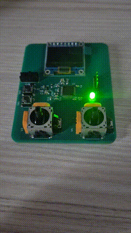
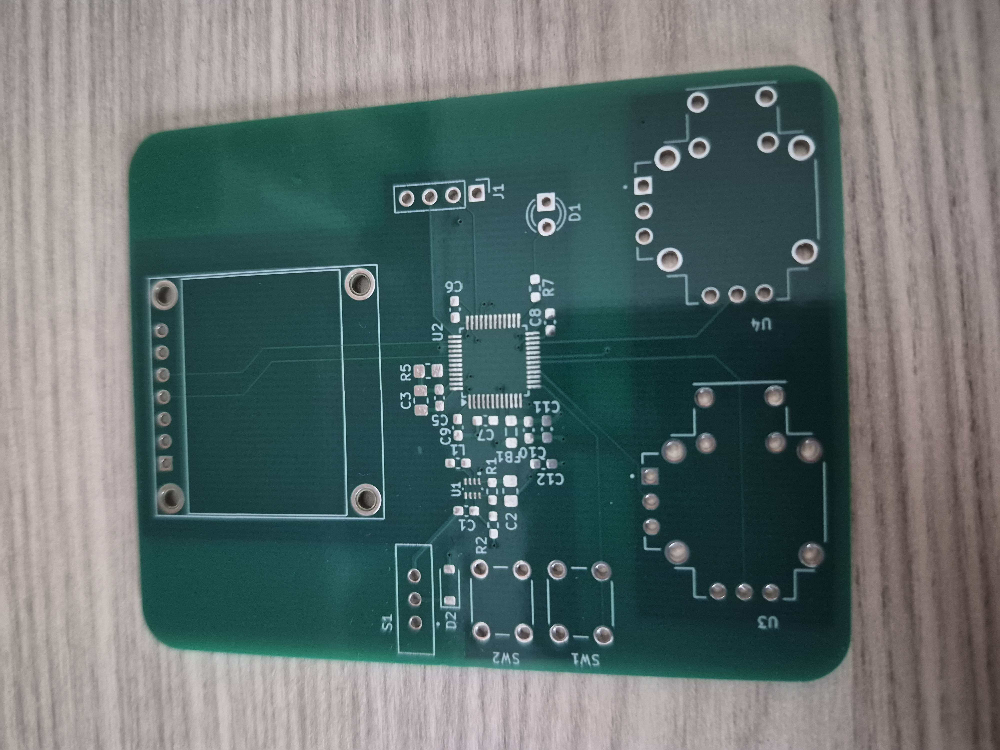
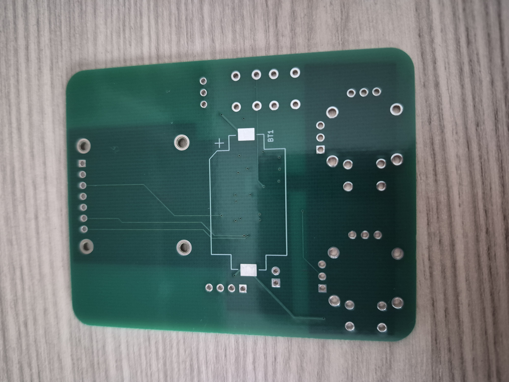
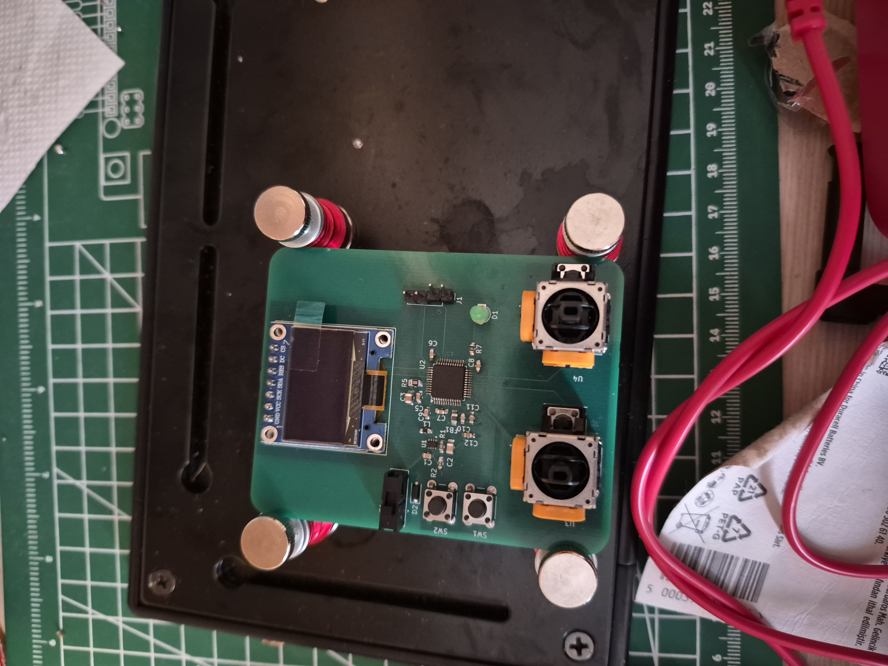
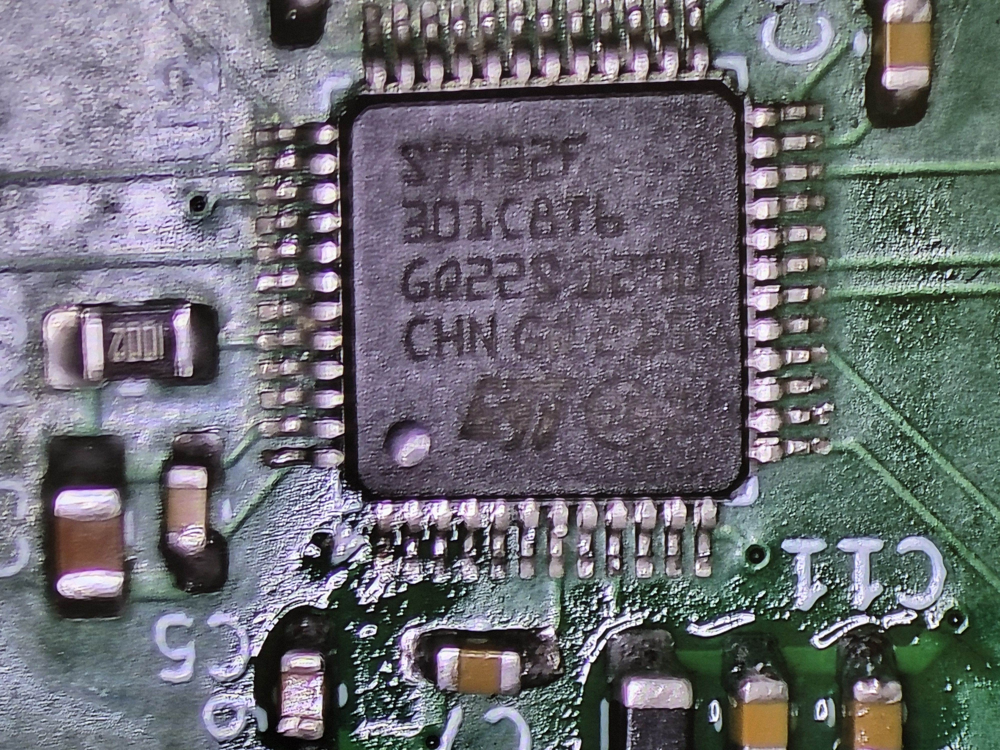

# PCB_3D_Renderer

THIS PROJECT AND README IS WORK IN PROGRESS AND NOT FINISHED

Currently the PCB is done and only the firmware is not finished.

A PCB with STM32 and SSD1306 to display 3D objects using a 3D Renderer that I made.

# Hardware

I used a 4 layer PCB with top and bottom layers being signal plane and inner layer 1 being GND plane (Both analog and digital) and inner layer 2 being +3.3V plane (Both analog and digital)

The project uses a STM32F301C8T6 MCU and a SSD1306 128x64 single color display.

# Software

The project is being programmed in bare metal using C. Currently the software is not complete.
